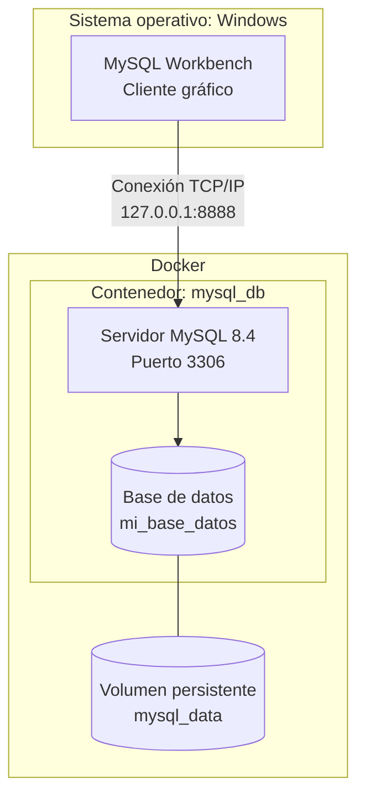
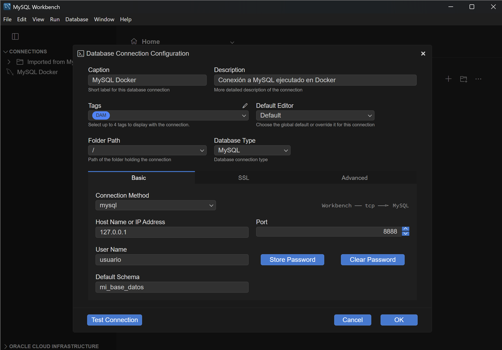

# MySQL con Docker Compose

## Introducción

Docker permite ejecutar MySQL dentro de un contenedor, sin necesidad de instalar MySQL Server directamente en nuestro sistema operativo.

En esta configuración utilizamos **MySQL Workbench** como herramienta gráfica para conectarnos al servidor y gestionar las bases de datos.

## ¿Cómo funciona?

El funcionamiento se divide en dos componentes:

- **Docker:** ejecuta el servidor MySQL dentro de un contenedor. También gestiona su configuración, los puertos y el almacenamiento persistente.
- **MySQL Workbench:** es la aplicación que utilizamos para conectarnos al servidor, crear bases de datos, consultar tablas, insertar registros y administrar la información.

Por tanto, únicamente necesitamos Docker y MySQL Workbench. No necesitamos instalar MySQL Server en Windows ni desarrollar una aplicación adicional.

## Arquitectura de funcionamiento

El siguiente diagrama representa cómo se comunican los componentes:



### ¿Qué ocurre durante la conexión?

1. Docker inicia el contenedor que ejecuta el servidor MySQL.
2. MySQL queda disponible en el puerto interno `3306`.
3. Docker publica ese puerto en Windows mediante el puerto `8888`.
4. MySQL Workbench se conecta utilizando `127.0.0.1:8888`.
5. Una vez conectado, podemos administrar la base de datos y ejecutar consultas SQL.
6. Los datos se almacenan en el volumen persistente `mysql_data`.

## Configuración de conexión

Para conectar MySQL Workbench con el servidor Docker utilizamos los siguientes datos:

| Parámetro | Valor |
|---|---|
| Host | `127.0.0.1` |
| Puerto | `8888` |
| Usuario | `usuario` |
| Contraseña | `usuario123` |
| Base de datos | `mi_base_datos` |

**Importante:** el puerto `8888` corresponde a Windows, mientras que `3306` es el puerto interno del contenedor. Docker se encarga de redirigir las conexiones entre ambos.

## Ejecución del servicio

Desde el directorio donde se encuentra el archivo `compose.yaml`, podemos utilizar los siguientes comandos:

```bash
# Iniciar MySQL en segundo plano
docker compose up -d

# Comprobar el estado del servicio
docker compose ps

# Consultar los registros
docker compose logs mysql

# Detener el servicio
docker compose stop

# Volver a iniciarlo
docker compose start

# Eliminar el contenedor
docker compose down
```

**Importante:** `docker compose down` elimina el contenedor, pero conserva el volumen de datos. En cambio, `docker compose down -v` también elimina los volúmenes y puede provocar la pérdida de la información almacenada.

## CONEXIÓN CON MYSQL WORKBENCH


> **NOTA:** dentro de workbench ve a crear una nueva conexión y añade la configuración que esta en la captura. Esta configuración puede variar dependiendo de la configuración del fichero [.env](./.env)

## Documentación oficial

- [Docker Compose](https://docs.docker.com/compose/)
- [Docker Volumes](https://docs.docker.com/engine/storage/volumes/)
- [Imagen oficial de MySQL](https://hub.docker.com/_/mysql)
- [Manual oficial de MySQL](https://dev.mysql.com/doc/refman/8.4/en/)
- [MySQL Workbench](https://dev.mysql.com/doc/workbench/en/)