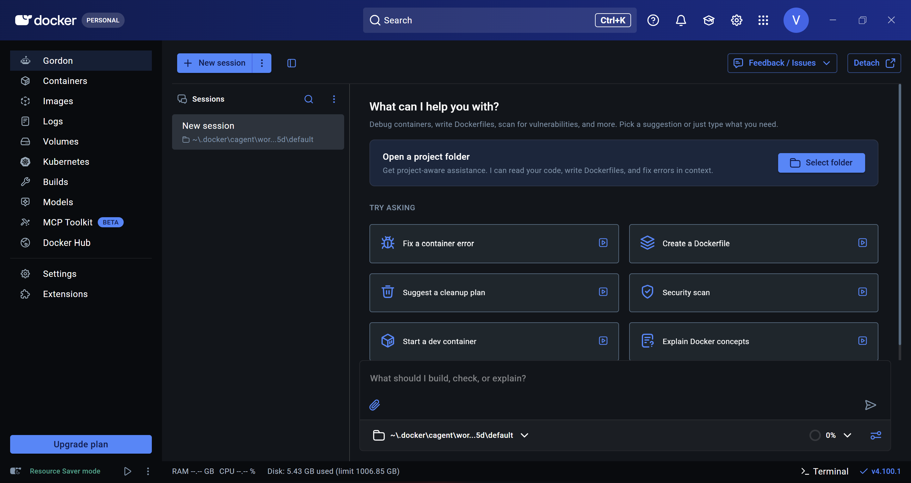

# Docker Desktop – Introducción a la interfaz

## 1. Vista general

Docker Desktop dispone de una interfaz gráfica que permite gestionar los recursos y herramientas de Docker de forma visual, sin necesidad de utilizar constantemente comandos desde la terminal.

La interfaz principal se divide en tres zonas:

- **Barra de navegación lateral (Navigation bar):** permite acceder a las diferentes secciones y funcionalidades de Docker Desktop.
- **Barra superior (Header):** contiene herramientas de búsqueda, ayuda, notificaciones, aprendizaje y acceso a la configuración y al perfil.
- **Área de trabajo (Workspace):** muestra el contenido correspondiente a la sección seleccionada.

### 1.1. Distribución de la interfaz

A continuación, se muestra una imagen general de Docker Desktop, indicando las principales zonas de la interfaz.

> **Figura 1.** Vista general de Docker Desktop: barra lateral, cabecera y área de trabajo.
---

## 2. Barra de navegación lateral (Navigation bar)

La barra de navegación lateral permite desplazarse entre las diferentes secciones de Docker Desktop. Cada apartado proporciona acceso a una funcionalidad específica del entorno.

| Sección | Descripción |
|---|---|
| **Gordon** | Asistente de inteligencia artificial integrado en Docker Desktop. Permite consultar dudas, obtener ayuda y realizar tareas relacionadas con Docker mediante instrucciones en lenguaje natural. |
| **Containers** | Permite visualizar y gestionar los contenedores existentes. Desde aquí se pueden iniciar, detener, reiniciar, eliminar y consultar los detalles de cada contenedor. |
| **Images** | Permite administrar las imágenes Docker disponibles localmente. Se pueden consultar, descargar, eliminar y gestionar las imágenes utilizadas para crear contenedores. |
| **Logs** | Centraliza la consulta de registros generados por los recursos y servicios de Docker, facilitando la detección de errores y el seguimiento de su funcionamiento. |
| **Volumes** | Permite gestionar los volúmenes utilizados para almacenar datos de forma persistente, independientemente del ciclo de vida de los contenedores. |
| **Kubernetes** | Permite habilitar y gestionar un entorno local de Kubernetes para desplegar y administrar aplicaciones mediante contenedores. |
| **Builds** | Permite consultar y gestionar los procesos de construcción de imágenes Docker, incluyendo el historial y los resultados de las compilaciones. |
| **Models** | Permite acceder a funcionalidades relacionadas con modelos de inteligencia artificial y su ejecución mediante el entorno Docker. |
| **MCP Toolkit** | Proporciona herramientas para configurar y gestionar servidores MCP (Model Context Protocol), facilitando la conexión de aplicaciones y agentes de inteligencia artificial con diferentes herramientas y servicios. |
| **Docker Hub** | Permite acceder a Docker Hub, el registro de imágenes y repositorios de Docker, para buscar imágenes, consultar repositorios y gestionar recursos asociados a la cuenta. |
| **Settings** | Permite configurar Docker Desktop, incluyendo recursos del sistema, motor de Docker, redes, proxies, Kubernetes y otras preferencias. |
| **Extensions** | Permite instalar y administrar extensiones que amplían las funcionalidades de Docker Desktop mediante herramientas adicionales. |

---

## 3. Barra superior (Header)

La barra superior contiene diferentes herramientas que facilitan la búsqueda de recursos, la resolución de problemas, el acceso a información y la configuración de Docker Desktop.

### 3.1. Search

Permite buscar recursos, funcionalidades y contenido dentro de Docker Desktop. Facilita el acceso rápido a diferentes secciones sin tener que localizarlas manualmente en la barra lateral.

### 3.2. Troubleshoot

Proporciona herramientas de diagnóstico y resolución de problemas relacionados con Docker Desktop.

Permite consultar información de diagnóstico, acceder a herramientas de soporte y recopilar datos que pueden ayudar a identificar errores de funcionamiento.

### 3.3. Notifications

Muestra notificaciones relacionadas con Docker Desktop, como avisos, actualizaciones, mensajes informativos y otros eventos relevantes del entorno.

### 3.4. Learning Center

Proporciona acceso a recursos de aprendizaje y documentación para conocer mejor Docker y sus funcionalidades.

Incluye tutoriales, guías y contenido formativo que ayudan a aprender a utilizar las diferentes herramientas de Docker Desktop.

### 3.5. Settings

Proporciona acceso directo a la configuración general de Docker Desktop.

Desde aquí se pueden modificar las preferencias de funcionamiento y administrar diferentes aspectos del entorno.

### 3.6. Menú de aplicaciones (Icono de nueve puntos)

Representado mediante un icono formado por nueve puntos, permite acceder a otras herramientas y servicios del ecosistema Docker.

Su contenido puede variar en función de la versión de Docker Desktop y de los servicios disponibles.

### 3.7. Perfil de usuario

Permite acceder a la información de la cuenta de Docker utilizada en Docker Desktop.

Desde este apartado se pueden consultar opciones relacionadas con la sesión, la cuenta y la gestión del perfil.